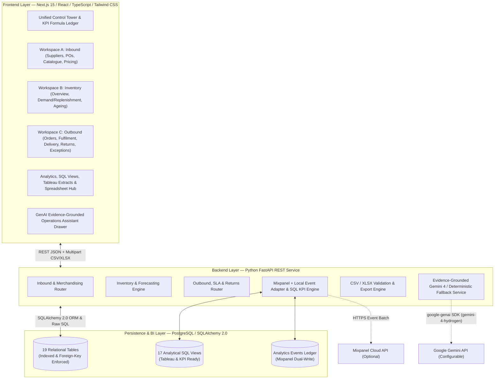

# THREADFLOW — Fashion Supply Chain & Merchandising Control Tower
## Product Requirements Document (PRD) & Enterprise Architecture Specification

**Document Version:** 2.4.0  
**Status:** Production Baseline  
**Target Users:** Category Managers, Procurement Specialists, Inventory & Demand Planners, Warehouse Operations Leads, Fulfilment & Returns Analysts  
**Data Policy:** All pre-loaded records are 100% synthetic operational data (`is_synthetic = true`) with strict referential integrity across procurement, inventory, fulfilment, and reverse logistics.

---

## 1. Executive Summary & Problem Statement

Fashion and apparel retail operations suffer from fragmented visibility across three interdependent operational horizons:

1. **Inbound Procurement & Merchandising Catalogue:**
   - **Supplier Opacity:** Tier-1 and Tier-2 garment manufacturers operate with variable lead times (12–35 days), unacknowledged purchase orders (POs), and short-shipments (GRN quantity discrepancies).
   - **Catalogue Readiness Bottlenecks:** SKUs arrive at regional warehouses while missing critical merchandising attributes (size charts, GSM/fabric composition, wash-care instructions, high-resolution imagery) or suffering from duplicate style listings, delaying live listing and inflating size-related customer returns.
   - **Margin Erosion:** Uncoordinated promotional discounting and input cost fluctuations erode target category gross margins without real-time guardrail alerts.

2. **Inventory & Replenishment Intelligence:**
   - **Bimodal Inventory Distortion:** High-velocity core sizes (M, L) experience stockouts in Tier-1 regional hubs while fringe sizes or late-season styles accumulate in 90+ day ageing buckets.
   - **Opaque Forecasting:** Black-box demand models fail to gain planner trust. Planners require transparent, auditable baseline forecasting (weighted 7-day and 30-day moving averages) paired with explicit safety stock and reorder point formulas.

3. **Outbound Order Fulfilment, Delivery & Returns:**
   - **Warehouse Processing Bottlenecks:** Picking and packing backlogs in high-utilization fulfilment centres breach dispatch SLAs before parcels even reach last-mile carriers.
   - **Last-Mile & Reverse Logistics Leakage:** Apparel return rates (16%–28%) driven by size/fit mismatches, quality defects, and catalogue inaccuracies require structured RMA workflows, quality-check (QC) grading, instant/NEFT refund simulation, and automated root-cause feedback loops back to Inbound Catalogue and Supplier teams.

**THREADFLOW** unifies these three workspaces into a single operational control tower with shared relational data, real-time workflow state transitions, Mixpanel + SQL product telemetry, Tableau-ready analytical views, spreadsheet import/export pipelines, and an evidence-grounded GenAI Operations Assistant.

---

## 2. System Architecture

---

## 3. User Personas & Operational Workflows

| Persona | Primary Workspace | Core Operational Actions | Key Success Metrics |
| :--- | :--- | :--- | :--- |
| **Procurement Lead** | Inbound (`Suppliers`, `PO Register`) | Onboard/audit suppliers, issue POs, track supplier acknowledgement, record Goods Receipt Notes (GRN), flag quantity discrepancies. | Supplier On-Time Delivery (OTD %), PO Fill Rate %, Avg Lead Time (Days) |
| **Category Merchandiser** | Inbound (`Catalogue`, `Pricing & Promos`) | Audit SKU completeness scores, remediate missing size charts/images, resolve duplicate SKUs, adjust MRP/selling price, schedule promotions within gross margin guardrails. | Catalogue Completeness %, Category Gross Margin %, Promo Uplift % |
| **Inventory Planner** | Inventory (`Overview`, `Demand & Replenishment`, `Performance`) | Monitor warehouse-SKU stock cover, review 7d/30d moving average forecasts, convert reorder recommendations directly into draft/issued POs, execute stock adjustments. | Stockout Rate %, Days of Cover (DOC), Inventory Turnover, Sell-Through %, Excess Stock Value (INR) |
| **Warehouse Ops Manager** | Outbound (`Order Management`, `Fulfilment`, `Exceptions`) | Allocate orders, advance picking/packing/dispatch states, assign carriers and AWB numbers, balance picker capacity, resolve warehouse bottlenecks. | Order Fulfilment Time (Hrs), Dispatch SLA Compliance %, Cancellation Rate % |
| **CX & Returns Analyst** | Outbound (`Delivery Intelligence`, `Returns & Exchanges`) | Track carrier transit delays, process RMA requests, log QC inspection outcomes, trigger size exchanges or simulate refunds, escalate recurring SKU defects. | On-Time Delivery %, Return Rate %, QC Pass Rate %, Exception Resolution Time (Hrs) |

---

## 4. Transparent Demand Forecasting Methodology & Documented Limitations

In accordance with enterprise governance requirements, THREADFLOW uses **transparent, deterministic baseline forecasting methods** rather than unverified black-box machine learning claims:

### 4.1 Mathematical Formulation
1. **Weighted Moving Average Daily Demand ($\hat{D}_i$):**
   $$\hat{D}_i = 0.60 \times \text{ADS}_{7\text{d}, i} + 0.40 \times \text{ADS}_{30\text{d}, i}$$
   where $\text{ADS}_{7\text{d}, i}$ is the observed 7-day average daily unit sales and $\text{ADS}_{30\text{d}, i}$ is the 30-day average daily unit sales for SKU-Warehouse pair $i$.
2. **Days of Inventory Cover ($\text{DOC}_i$):**
   $$\text{DOC}_i = \frac{\text{Available Qty}_i}{\max(\hat{D}_i, 0.1)}$$
3. **Safety Stock ($\text{SS}_i$):**
   $$\text{SS}_i = Z_{0.95} \times \sigma_D \times \sqrt{L_s} \approx \lceil \hat{D}_i \times \max(5, 0.35 \times L_s) \rceil$$
   where $L_s$ is the supplier's actual average lead time in days.
4. **Reorder Point ($\text{ROP}_i$) & Recommended Order Quantity ($\text{ROQ}_i$):**
   $$\text{ROP}_i = (\hat{D}_i \times L_s) + \text{SS}_i$$
   $$\text{ROQ}_i = \max\left(0, \lceil (\hat{D}_i \times (L_s + R)) + \text{SS}_i - (\text{Available Qty}_i + \text{In-Transit Qty}_i) \rceil\right)$$
   where $R = 14\text{ days}$ is the standard review cycle buffer.

### 4.2 Documented Limitations
- **Historical Lag & Trend Sensitivity:** Moving averages are backward-looking and lag behind sudden inflection points (e.g., viral influencer spikes or abrupt end-of-season drop-offs).
- **Censored Demand During Stockouts:** When `available_qty = 0`, observed sales drop to zero, artificially depressing $\text{ADS}_{7\text{d}}$ unless stockout days are adjusted.
- **Price & Promotion Elasticity:** Baseline moving averages do not endogenously model price elasticity from upcoming promotional campaigns without explicit planner override.
- **No Unverified Accuracy Claims:** No MAPE/WAPE predictive superiority is claimed without out-of-sample backtesting on live production cohorts.
